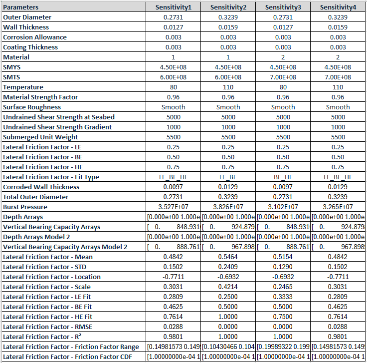
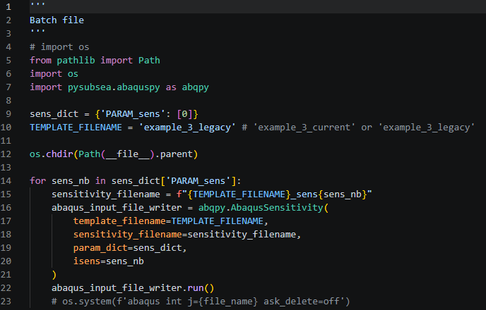
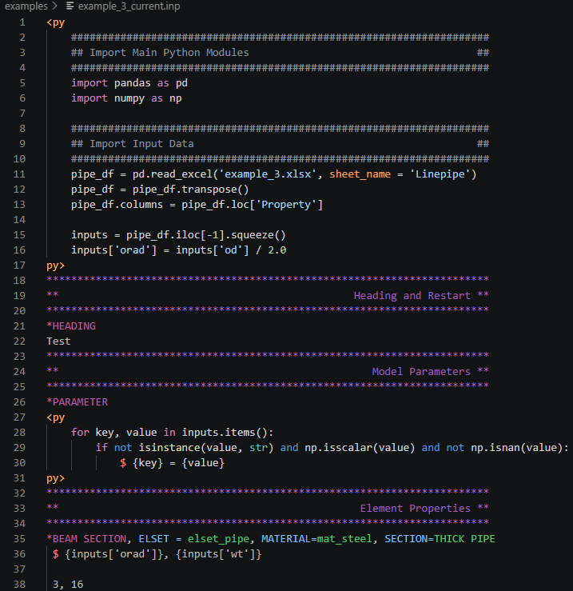
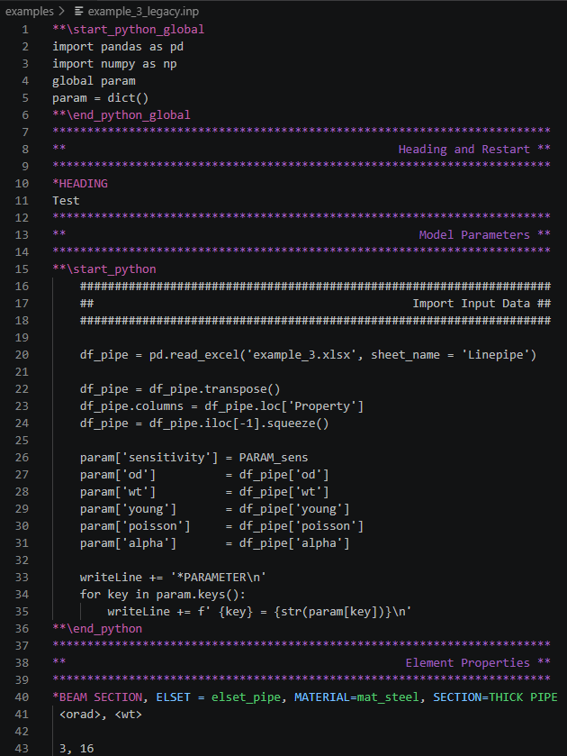

###############
Getting Started
###############

.. raw:: html

   

**************************************
About PySubsea: A Foundational Library
**************************************

PySubsea is designed as a foundational library for pipeline and riser design. A foundational library provides core building blocks and reusable components that can be used directly in your own scripts, applications, or larger frameworks. It is not a standalone application, but rather a toolkit that enables rapid development and robust analysis by providing well-tested, well-documented, and efficient functions and classes.

What is a Foundational Library?
-------------------------------

A foundational library is a collection of essential tools and abstractions that serve as the basis for more complex workflows and applications. It is intended to be imported and used as a dependency in your own Python code, rather than run as a program by itself. Foundational libraries are typically:

- Modular and extensible
- Well-documented and tested
- Focused on core functionality, not user interfaces
- Designed for integration into other projects

Current Modules in PySubsea
---------------------------

PySubsea currently includes the following modules:

- :doc:`linepipe_tools`: Provides ``Pipe`` for pipe geometry, material properties, stiffness, weights, masses, and specific mass ratios.
- :doc:`limit_state_tools`: Provides ``MaterialStrength`` for temperature derating and material strength calculations, and ``LimitStates``.
- :doc:`lateral_buckling_tools`: Provides ``LBSoilDistributions`` for friction factor fitting, ``LBOOSDistributions`` for OOS factor distributions, and ``LBForceDistributions`` for straight-section, route-curve, sleeper, and mixed-section buckling force distributions.
- :doc:`upheaval_buckling_tools`: Provides ``PropType`` for natural prop-type span length, lift-off force, and Euler buckling force calculations.
- :doc:`pipe_soil_interaction_tools`: Provides ``PSI`` for vertical penetration resistance using undrained soil models and per-pipe shear strength profiles.
- :doc:`pipe_soil_interaction_dynamic_tools`: Provides ``PSIDynamic`` for soil property lookup and horizontal and vertical dynamic soil stiffness calculations.
- :doc:`oos_tools`: Provides ``OOSDespiker``, ``OOSCurvature``, ``FFTSmoother``, ``OOSAnonymisation``, and ``GaussianSmoother`` for survey processing, despiking, geometry, smoothing, spectral analysis, and anonymisation.
- ``abaquspy.py``: Includes the ``AbaqusSensitivity`` class for generating sensitivity files and automating input preparation for Abaqus finite element analysis.

Each module can be used independently or in combination, depending on your
analysis needs. The :doc:`api_reference` pages list class inputs and group methods
by their outputs.

Installing PySubsea
-------------------

PySubsea requires Python 3.10 or newer. It is distributed through the Python
Package Index (PyPI) and can be installed using pip.

Install the latest stable release with:

.. code-block:: bash

   python -m pip install pysubsea

This command downloads and installs PySubsea together with its required Python dependencies.

Working with the Repository
---------------------------

To use the current source code, including the API renames described here, run
the following from the repository root:

.. code-block:: console

   python -m pip install -e .

Install the optional example or documentation dependencies as needed:

.. code-block:: console

   python -m pip install -e ".[examples]"
   python -m pip install -e ".[docs]"

Using the Current API
---------------------

Public engineering classes can be imported from the package root:

.. code-block:: python

   from pysubsea import (
       Pipe, MaterialStrength, LimitStates, PSI, PSIDynamic,
       LBSoilDistributions, LBOOSDistributions, LBForceDistributions,
       PropType, OOSAnonymisation, OOSDespiker, OOSCurvature,
       FFTSmoother, GaussianSmoother,
   )

Imports from individual modules are also supported:

.. code-block:: python

   from pysubsea.limit_state_tools import MaterialStrength, LimitStates
   from pysubsea.pipe_soil_interaction_dynamic_tools import PSIDynamic

For ``LBForceDistributions``, each section-specific distribution method returns
the mean force as the first item of its result tuple. The standalone mean-force
methods have been removed. Use ``buckling_force_distribution_parameters`` to
dispatch mixed ``Straight``, ``Curve``, and ``Sleeper`` cases in input order.

AbaqusPy: A Python Preprocessor for Abaqus Input Files
------------------------------------------------------

AbaqusPy is an open-source framework, distributed as part of PySubsea, that provides a lightweight Python-based preprocessing and templating layer for Abaqus `.inp` workflows. It is intended to become a standalone project as it matures.

AbaqusPy allows Python logic to be embedded directly within Abaqus input files while maintaining compatibility with standard Abaqus syntax. During preprocessing, AbaqusPy evaluates the embedded Python code and generates a standard executable Abaqus `.inp` file.

AbaqusPy extends the standard Abaqus `.inp` syntax with:

- `<py` and `py>` blocks for embedded Python logic, loops, calculations, and variable definitions
- `$` output markers for writing Python-generated lines into the final executable Abaqus `.inp` file

An AbaqusPy Visual Studio Code extension is also available, providing syntax highlighting for both Abaqus input files and AbaqusPy extensions, https://marketplace.visualstudio.com/.

.. raw:: html

   

****************************
Testing the PySubsea Package
****************************

The repository contains a doctest runner and separate unittest regression tests.
Run them against an editable installation to check the current source code.

How to Run the Tests
--------------------

Run the docstring examples from the repository root:

.. code-block:: bash

   python test_pysubsea.py

Run the unittest regression tests separately:

.. code-block:: console

   python -m unittest discover -v

For focused regression checks:

.. code-block:: console

   python -m unittest test_pipe_spanning test_lateral_buckling -v

What Does It Test?
------------------

The ``test_pysubsea.py`` script will automatically run doctests for the following libraries:

- ``linepipe_tools``
- ``limit_state_tools``
- ``lateral_buckling_tools``
- ``pipe_soil_interaction_tools``
- ``upheaval_buckling_tools``
- ``pipe_soil_interaction_dynamic_tools``

Each method in these libraries that includes a docstring example will be tested. The script will print a summary of the number of tests attempted, passed, and failed.

The doctest runner does not currently include ``oos_tools`` or ``abaquspy``.
The regression tests include pipe mass ratios and
dynamic PSI inputs in ``test_pipe_spanning.py``, and distribution dispatch,
broadcasting, and output shapes in ``test_lateral_buckling.py``.

.. raw:: html

   

***********************
Running Example Scripts
***********************

The ``examples`` directory contains ``example_1_pysubsea.py``,
``example_2a_pysubsea.py``, and ``example_3_pysubsea.py``, together with their
input data. Install the ``examples`` dependencies before running them.

How to Run the Example
----------------------

Run the scripts from the ``examples`` directory so that relative input paths
resolve correctly:

.. code-block:: bash

   cd examples
   python example_1_pysubsea.py
   python example_2a_pysubsea.py
   python example_3_pysubsea.py

The scripts write output files and/or display plots. The synthetic-signal
Example 2b figures below are retained as reference material; an
``example_2b_pysubsea.py`` script is not currently included.

What Does It Demonstrate?
-------------------------

**The ``example_1_pysubsea.py`` script contains examples to demonstrate:**

Demonstrates ``Pipe`` geometry, ``LimitStates`` burst pressure, ``PSI`` undrained
penetration resistance with per-pipe shear strength profiles, and
``LBSoilDistributions`` friction factor fitting.

   Example 1: Pipe Properties, Limit States, PSI and Soil Distributions

**The ``example_2a_pysubsea.py`` script contains examples to show:**

OOS Example: Shows how to use the ``OOSAnonymisation``, ``OOSDespiker``, ``OOSCurvature``, ``FFTSmoother``, ``GaussianSmoother`` classes for group-wise signal processing and survey data anonymisation.

.. figure:: _static/example_2a_plot1.png
   :alt: Example 2a Plot 1
   :width: 600
   :align: center

   Example 2a, Plot 1: Survey Route Overview. This plot is useful to visualise the out-of-straightness per survey section. It splits the survey route into individual sections and displays the out-of-straightness for each section, distinguishing between nominally straight and curved sections. It also shows locations where survey points have been despiked.

.. figure:: _static/example_2a_plot2.png
   :alt: Example 2a Plot 2
   :width: 600
   :align: center

.. figure:: _static/example_2a_plot2b.png
   :alt: Example 2a Plot 2b
   :width: 600
   :align: center

   Example 2a, Plot 2: Anonymised Smoothing. These plots intend to visualise how the anonymisation and smoothing processes affect the survey data at the pipeline group level.

.. figure:: _static/example_2a_plot3.png
   :alt: Example 2a Plot 3
   :width: 600
   :align: center

   Example 2a, Plot 3: Spectral Analysis - Coordinates. This plot visualises the wavelength distribution of the survey data, highlighting the noise associated with the survey.

.. figure:: _static/example_2a_plot4.png
   :alt: Example 2a Plot 4
   :width: 600
   :align: center

   Example 2a, Plot 4: Curvatures Smoothing. This plot is useful to visualise the smoothing effects on the curvature.

.. figure:: _static/example_2a_plot5.png
   :alt: Example 2a Plot 5
   :width: 600
   :align: center

   Example 2a, Plot 5: Spectral Analysis - Curvatures. This plot visualises the radius of curvature distribution of the survey data, highlighting the noise associated with the survey curvatures.

**Example 2b: Synthetic Signal Reference Figures**

These reference figures illustrate despiking, curvature calculations, FFT
filtering, and Gaussian smoothing of a synthetic signal.

.. figure:: _static/example_2b_plot1.png
   :alt: Example 2b Plot 1
   :width: 600
   :align: center

   Example 2b, Plot 1: Synthetic signal composed of four harmonics.

.. figure:: _static/example_2b_plot2.png
   :alt: Example 2b Plot 2
   :width: 600
   :align: center

   Example 2b, Plot 2: Comparison of the original synthetic signal and a signal with the two shortest-wavelength harmonics filtered out using FFTSmoother.

.. figure:: _static/example_2b_plot3.png
   :alt: Example 2b Plot 3
   :width: 600
   :align: center

   Example 2b, Plot 3: Spectral Analysis - Coordinates. This plot visualises the wavelength distribution of the synthetic signal, highlighting the four harmonic peaks.

.. figure:: _static/example_2b_plot4.png
   :alt: Example 2b Plot 4
   :width: 600
   :align: center

   Example 2b, Plot 4: Curvatures Smoothing. In this plot, the original and filtered signal curvatures are compared.

.. figure:: _static/example_2b_plot5.png
   :alt: Example 2b Plot 5
   :width: 600
   :align: center

   Example 2b, Plot 5: Spectral Analysis - Curvatures. This plot visualises the radius of curvature distribution of the synthetic signal, highlighting the noise associated with the synthetic signal curvatures.

**The ``example_3_pysubsea.py`` script contains examples to illustrate:**

AbaqusSensitivity Example: Illustrates how to use the ``AbaqusSensitivity`` class from AbaqusPy for generating Abaqus input files with sensitivity analysis.

Recommended import style:

.. code-block:: python

   from pysubsea.abaquspy import AbaqusSensitivity

   Example 3: General Overview of a Master Abaqus Input File - Current Format.

   Example 3: Master Abaqus Input File - Current Format.

   Example 3: Master Abaqus Input File - Legacy Format.

Building the Documentation
--------------------------

After installing the ``docs`` dependencies, run from the repository root:

.. code-block:: console

   python -m sphinx -E -a -W -b html docs docs/_build/html

This rebuilds every page with a fresh Sphinx environment, ensuring navigation
reflects renamed or moved modules. Open ``docs/_build/html/index.html`` and
refresh the browser after rebuilding.